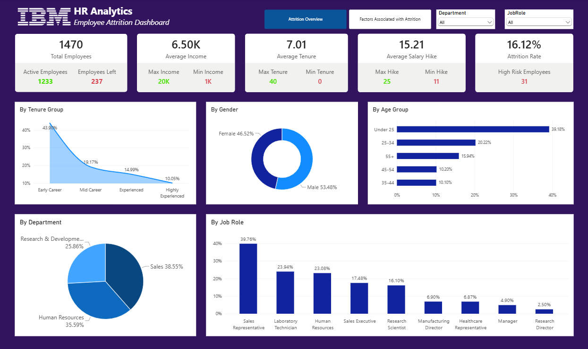
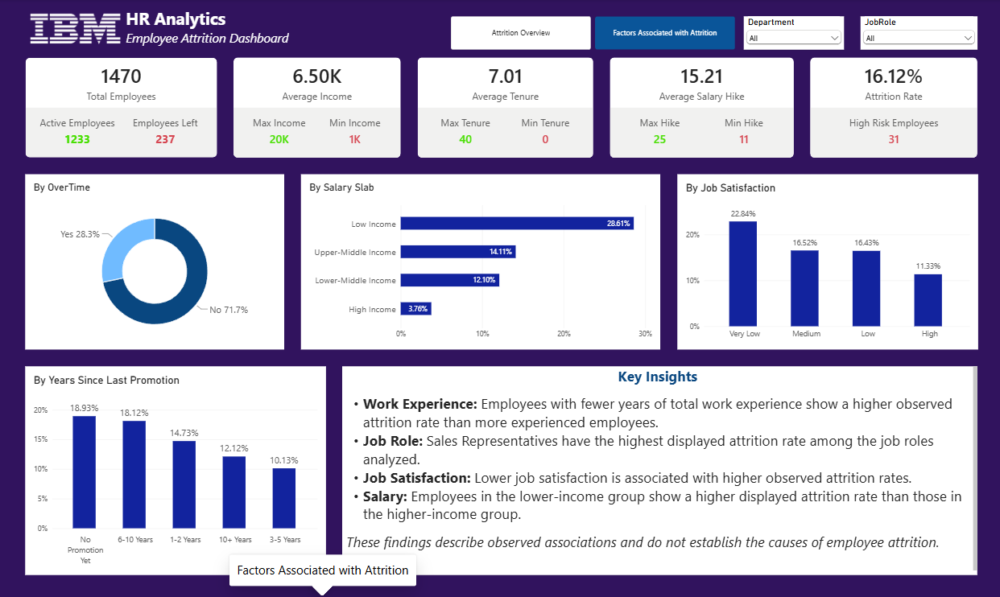

# IBM HR Analytics — Employee Attrition Analysis

## Project Overview
This project explores employee attrition and workforce patterns using **SQL Server** and **Power BI**. The objective is to identify employee groups with higher attrition rates and examine workforce trends to support data-driven HR decisions.

## Tools & Technologies
- **SQL Server** — Data exploration, data quality checks, aggregations, and attrition analysis
- **Power BI** — Interactive dashboard, DAX measures, KPIs, and visual analysis
- **Microsoft Excel / CSV** — Dataset source and preparation

## Dashboard Preview

### 1. Attrition Overview

This page presents key workforce metrics and explores attrition across departments, gender, age groups, job roles, and total work experience.

### 2. Factors Associated with Attrition

This page examines attrition patterns across overtime, job satisfaction, salary groups, and promotion-related factors.

## Key Findings
- The dataset contains **1,470 employees**, of whom **237 left the company**.
- The overall attrition rate is **16.12%**.
- Attrition rates vary across job roles, satisfaction levels, and salary groups.
- The dashboard highlights workforce segments that may warrant further investigation.

*These findings describe observed associations and do not establish causation.*

## SQL Analysis
The SQL script includes:
- Data quality checks and duplicate employee-number checks
- Overall employee attrition analysis
- Attrition by department, job role, and overtime
- Analysis by salary groups and work-experience categories
- Examination of job satisfaction and combined employee segments

## Project Files
| File | Description |
|---|---|
| `IBM_HR_Analytics_Final.pbix` | Interactive Power BI report |
| `IBM_HR_Analytics_Final.sql` | SQL Server analysis queries |
| `Dashboard_Attrition_Overview.png` | Overview dashboard screenshot |
| `Dashboard_Factors_Affecting_Attrition.png` | Attrition factors screenshot |

## Dataset
IBM HR Analytics Employee Attrition & Performance dataset. The dataset contains employee demographics, job details, compensation, 
satisfaction ratings, and attrition status.

## How to Explore
1. Download the `.pbix` file and open it in Power BI Desktop.
2. Review the SQL script in SQL Server Management Studio or another compatible SQL editor.
3. Use the dashboard filters to explore workforce segments and attrition patterns.
